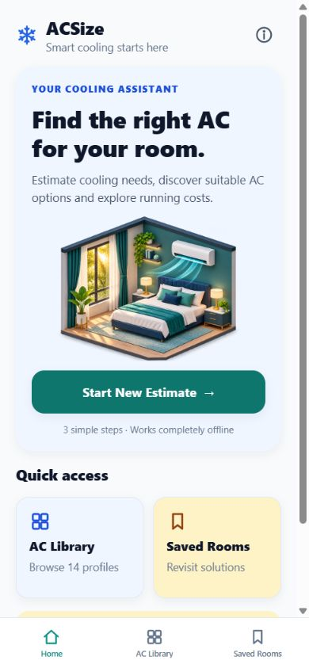
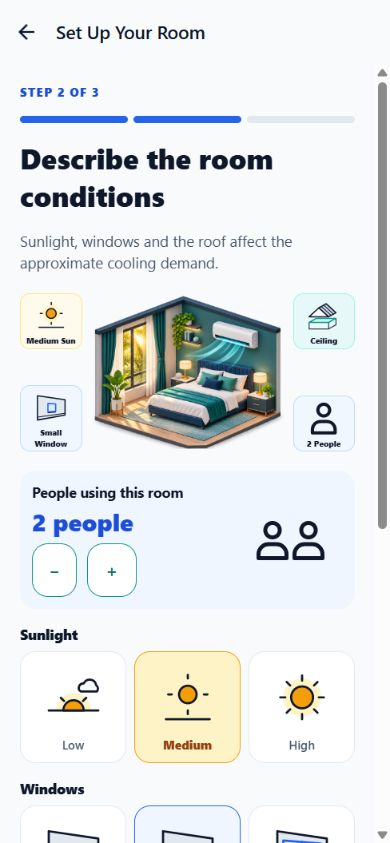
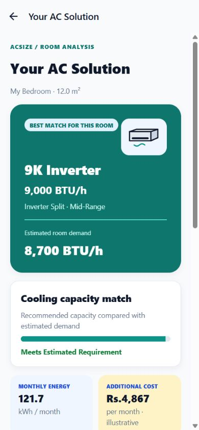
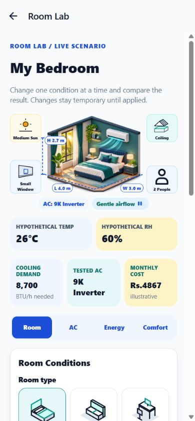
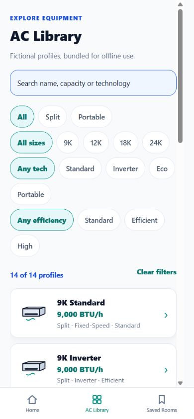

# ACSize

## Project overview and objective

ACSize is a fully offline, Android-first React Native application for estimating a room's approximate cooling demand and selecting a suitable generic AC profile. It was created for IT3133 Mobile Communication and Computing, ICA 03. Its objective is to make room measurements, capacity estimates and AC comparisons understandable without an internet connection.

The app is an educational selection assistant, not professional HVAC design software. Its equipment catalogue, comparison capacities, electrical inputs, purchase tiers, energy results and comfort labels are fictional or illustrative.

## Key features

- Seven real routes: Home, Room Setup, Recommendation, Room Lab, AC Library, AC Details and Saved Rooms.
- Three-step room setup with metric/imperial display, physical-value validation and preserved values.
- Pure, tested cooling, recommendation, energy and comfort calculations.
- Fourteen bundled generic AC profiles rendered dynamically with search and combined filters, plus 25 sourced Sri Lankan model examples grouped under every profile.
- An “Other enclosed room” option with a stated general adjustment and a neutral visual fallback. Kitchens, open halls and unusual equipment loads remain outside its scope.
- Split/portable no-match behavior, alternatives and separate nominal/comparison capacities.
- Interactive Room Lab with a temporary scenario, automatic versus manually selected AC, Reset and Apply.
- Three bundled transparent room illustrations for bedroom, living room and office, floor-aligned dimension guides, illustrated condition controls, and four Room Lab tabs.
- A continuous daily-use arc that changes from blue through teal to amber, plus restrained blue and amber accents throughout the app.
- Twenty-seven bundled modern duotone SVG icons for choices, airflow, AC profiles, navigation and occupants; a Library choice can be applied directly to a Room Lab scenario. The detailed room illustrations remain bundled images, resized to 900 × 600 for quicker loading.
- Local AsyncStorage create/open/edit/update/delete flows with versioned saved records.
- No runtime API, remote image, remote font, login, cloud database or other network dependency.

## Screenshots

These screenshots were captured from the app at a 390 × 844 mobile browser viewport on 14–15 November 2026, before the enclosed-room and Sri Lankan model additions. They show the app's mobile layout; updated installed Android screenshots and the airplane-mode device test are still pending.

| Home | Room Setup | Recommendation |
| --- | --- | --- |
|  |  |  |

| Room Lab | AC Library |
| --- | --- |
|  |  |

## Technologies used

- Expo SDK 58, React Native 0.88, React 19 and TypeScript 6.
- React Navigation 7 for the native stack and bottom tabs.
- AsyncStorage for versioned local saved rooms; `react-native-svg` for bundled vector icons.
- EAS Build for the Android preview APK; `tsx` and Node's test runner for calculation fixtures.

## Installation and setup

Requirements: Node.js 20.19 or newer, npm, and Expo Go or an Android development environment.

```powershell
npm install
npm run typecheck
npm test
npx expo-doctor
npm start
```

Scan the Metro QR code with Expo Go for development. Expo Go requires Metro and therefore is not proof of installed offline operation.

For a local Android development build, install Android Studio/SDK, make `adb` available, then run:

```powershell
npx expo run:android
```

For an installable preview APK, sign in to an Expo account and run the configured internal-distribution build profile:

```powershell
npx eas-cli@latest login
npx eas-cli@latest build --platform android --profile preview
```

The first build may ask to link an Expo project and create Android signing credentials. The `preview` profile in `eas.json` requests an APK with bundled application code. Development/build downloads may use the internet; the installed ACSize runtime does not. A [preview APK build](https://expo.dev/accounts/oshadha_anuhas/projects/acsize/builds/2abe2f1b-239c-4184-8ad5-55a2fb254377) succeeded from local commit `2185644`; installed-device behavior has not yet been verified.

## Project structure

- [App.tsx](./App.tsx) adds safe-area, shared room state and the root navigator.
- `src/navigation/` defines a typed native stack with Home/Library/Saved bottom tabs.
- `src/context/RoomContext.tsx` owns the working draft, temporary Lab scenario and hydrated saved records.
- `src/data/acProfiles.ts` is the single source of all 14 catalogue records.
- `src/data/sriLankanModels.ts` holds 25 offline reference listings, their source URLs and capacity classes. These examples never enter the sizing or energy calculations. Two shared, compressed product visuals illustrate split and portable units; they are not model photographs.
- `assets/icons-modern/` contains the supplied SVG sources and contact sheet. Run `node scripts/generate-icon-xml.mjs` after editing an SVG to update the local `src/data/iconXml.ts` module used by `react-native-svg`.
- `src/services/` contains pure calculations plus the serialized AsyncStorage service.
- `src/screens/` contains one component for each of the seven routes.
- `__tests__/core.test.ts` checks the locked dataset and deterministic acceptance fixtures.

### State lifecycle

The working draft is what Room Setup and Recommendation use. It is not persistent until **Save Solution** succeeds. Room Lab copies that draft into a temporary scenario; **Reset** restores its entry snapshot and **Apply Changes** transfers it back to the draft. A saved record changes only after an explicit save or confirmed delete. `recommendedACId` is derived from the current room; `selectedACId` is a user's explicit test choice.

## Calculation rules

Cooling demand uses canonical metres:

```text
areaM2 = lengthM × widthM
baseBTUh = areaM2 × 700
factor = room + sunlight + windows + roof + (heightM - 2.7) × 0.03
rawBTUh = baseBTUh × (1 + factor) + max(0, occupants - 2) × 500
estimatedBTUh = round(rawBTUh / 100) × 100
```

The default 4 × 3 × 2.7 m bedroom produces 8,652 raw, rounds to 8,700 BTU/h and selects `SPL-09-INV`. Selection first chooses the smallest sufficient comparison-capacity class, then applies the user's Standard/Inverter/Eco priority. Portable comparison capacities are an application-specific fictional 80% convention, not certified SACC values.

Energy uses:

```text
monthlyKWh = inputKW × dailyHours × 30 × 0.65
additionalChargeLKR = monthlyKWh × illustrativeRate
```

The 0.65 value is a fixed average-use multiplier, not electrical power factor. The default Rs.40/kWh is a demonstration assumption, not an official Sri Lankan tariff or complete household bill.

Comfort Explorer classifies hypothetical temperature, humidity and airflow as Cool, Comfortable or Warm. It does not display a physical feels-like temperature and cannot change BTU or energy calculations.

## Offline acceptance check

1. Create a release/preview Android build and install it on a device.
2. Open every route once, then close the app.
3. Enable airplane mode and disable Wi-Fi.
4. Restart ACSize and complete Room Setup → Recommendation → Room Lab.
5. Search/filter the Library, open Details, select an AC, save a room, restart, reopen/edit it, and delete it.
6. Record the device/build identifier and result for submission evidence.

This repository can verify bundling without an Android SDK using `npx expo export --platform android`, but that is not equivalent to the installed-device airplane-mode test.

### Export preflight (2026-11-04)

- `npx expo export --platform android` passed after directing Windows temp output to `tmp/expo-export` inside the project. It produced one 2.1 MB Hermes Android bundle and local assets in the ignored `dist/` directory.
- A source scan of `src/`, `App.tsx`, `index.ts` and `app.json` found no runtime fetch, WebSocket, HTTP URL or remote asset reference.
- The first `npx expo-doctor` attempt could not reach npm; a later run with registry access passed all 20 checks.
- After the M7 code changes, `npx expo install --check` reported compatible installed versions using Expo's local dependency map, and a fresh Android Hermes export passed. The offline compatibility check carries Expo's reliability warning.
- `npx tsc --noEmit`, `npx expo lint` and all 33 automated tests passed after the enclosed-room and model-catalogue updates. See the [acceptance status](Documentation/Acceptance_Status_2026-11-04.md) for earlier milestone evidence.
- An installed Android build and airplane-mode restart have **not** been tested yet.
- A mobile-width browser smoke test verified room setup, recommendation, Room Lab airflow feedback, and AC selection from Library and Details. This does not replace an installed-device test.

### Submission status (2026-11-14)

- A cloud preview APK was built successfully from local commit `2185644`. No Android SDK `adb` was found for an installed-device check.
- That APK predates the enclosed-room and Sri Lankan model catalogue changes; a new build is required to test those features on Android.
- The five screenshots above were captured from the mobile-width web preview.

If Windows blocks Hermes from writing to its default temp directory, run this PowerShell sequence before exporting:

```powershell
New-Item -ItemType Directory -Force -Path .\tmp\expo-export | Out-Null
$env:TEMP = (Resolve-Path .\tmp\expo-export).Path
$env:TMP = $env:TEMP
npx expo export --platform android
```

## Special features and known limitations

- Room Lab keeps experiments temporary until **Apply Changes**, and saved rooms change only on explicit save or confirmed delete.
- All catalogue data, images and icons are bundled so the installed app is designed to run offline.
- Supports bedrooms, living rooms, small offices and other enclosed rooms. The other-room factor is a general educational assumption, not a kitchen, open-hall or specialist-load calculation.
- Sri Lankan models are dated local listing examples, not live stock claims. Their actual appearance may differ from the shared illustrations. “Eco Inverter” is an ACSize comparison tier, not a certified product category; real models do not inherit the generic profile's illustrative energy or price values.
- Uses simplified heuristics and a maximum 24,000 BTU/h local split catalogue.
- Does not predict exact installation suitability, compressor cycling, real bills or physical comfort.
- The Git remote is [OshadhaAnuhas/ACSize](https://github.com/OshadhaAnuhas/ACSize).
